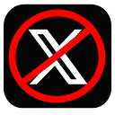
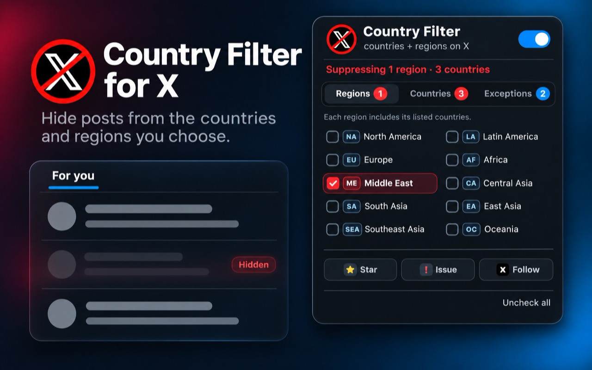
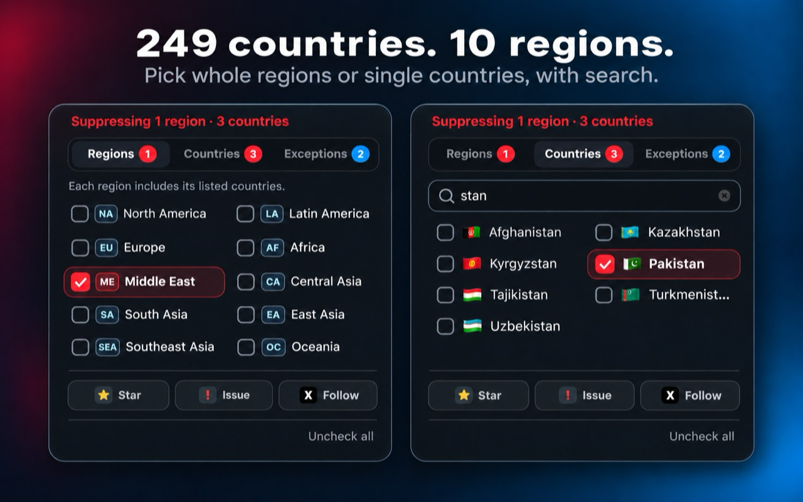
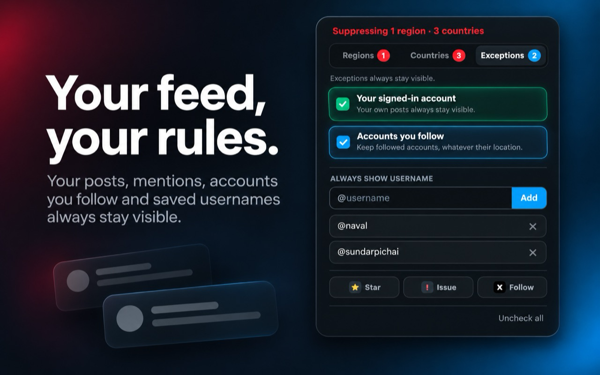
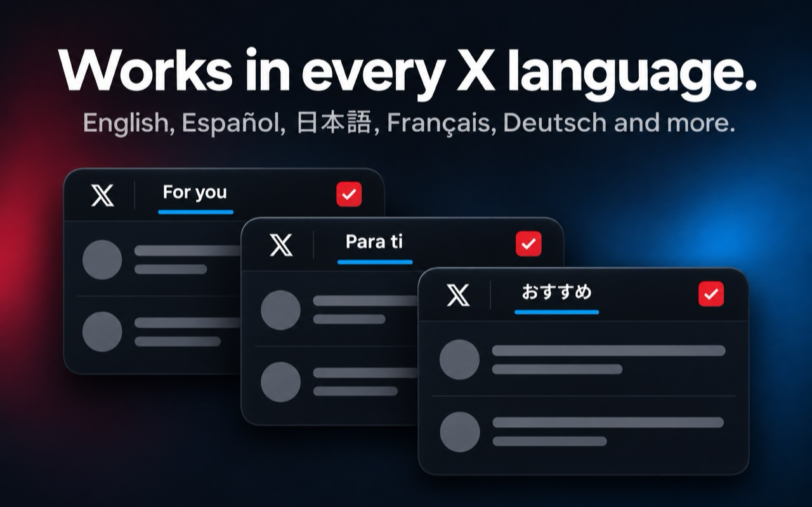
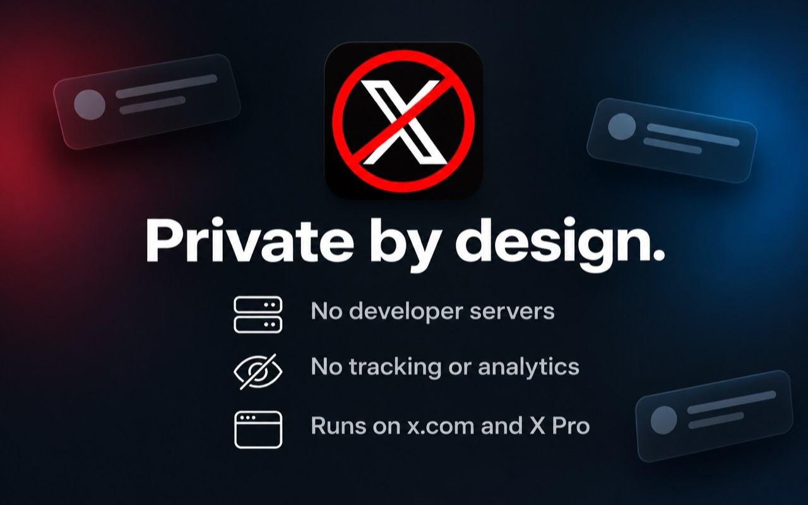

<p align="center">
  
</p>

<h1 align="center">Country Filter for X</h1>

<p align="center">
  <strong>Filter recommended Home feeds by country or region across X and X Pro.</strong>
</p>

<p align="center">
  <a href="https://chromewebstore.google.com/detail/country-filter-for-x-twit/cocohplmilpblbkoikolbhakjipccioa"></a>
  <a href="https://www.producthunt.com/products/country-filter-for-x-2"></a>
  <a href="https://github.com/apoorvdarshan/x-country-filter/stargazers"></a>
  <a href="LICENSE"></a>
</p>

Chrome extension (Manifest V3) that hides posts from countries or regions you pick in
the recommended Home feeds on **x.com**, including **X Pro** at **pro.x.com**.
It works in **For You** and selected topic tabs such as Software, Tech, and AI.
The **Following** tab, notifications, opened conversations and replies, profiles,
and search results stay untouched.

Need an override? Your signed-in account is always protected, so your own posts
remain visible. Direct mentions of your username stay visible too. You can also
add X usernames under **Exceptions**, or leave **Accounts you follow** enabled.
All four override every country and region filter.

The searchable catalog covers 249 countries and areas across 10 regions. Its
geographic grouping is based on the [United Nations M49 standard](https://unstats.un.org/unsd/methodology/m49/overview/)
and adapted to the extension's region labels, with Taiwan and Kosovo included
for labels commonly shown on X.

Support the project: [star it on GitHub](https://github.com/apoorvdarshan/x-country-filter),
[report an issue](https://github.com/apoorvdarshan/x-country-filter/issues/new),
[follow @apoorvdarshan on X](https://x.com/apoorvdarshan), or
[vote on Product Hunt](https://www.producthunt.com/products/country-filter-for-x-2).

## See it in action

<p align="center">
  
</p>

<table>
  <tr>
    <td width="50%">
      
    </td>
    <td width="50%">
      
    </td>
  </tr>
  <tr>
    <td width="50%">
      
    </td>
    <td width="50%">
      
    </td>
  </tr>
</table>

## Install

**[Install from the Chrome Web Store →](https://chromewebstore.google.com/detail/country-filter-for-x-twit/cocohplmilpblbkoikolbhakjipccioa)**
— the one-click option.

> The extension checks X's public "Account based in" metadata through your
> logged-in X session, then falls back to conservative local signals. See
> [How detection works](#how-detection-works).

### Install (developer mode)

1. Open `chrome://extensions`
2. Turn on **Developer mode** (top right)
3. Click **Load unpacked** and select this folder (`x-country-filter`)
4. Open x.com or pro.x.com (logged in), click the extension icon, check the countries you want gone

## How detection works

The extension combines independent signals into a confidence score:

1. **X's "Account based in" value** (strongest) — fetched from X's own
   `AboutAccountQuery`. Both exact countries and broad regions such as "South
   Asia" are recognized. Results are cached locally for up to 24 hours.
2. **Author's public profile location** — used as a fallback and mapped from
   free text ("Bengaluru, India" → IN, "San Francisco, CA" → US, "東京" → JP).
   Every catalog country supports exact names and common aliases; the original
   hand-tuned countries also recognize major cities and native-script names.
   An opened profile's visible location and Follow/Following button are
   remembered for that author's Home-feed posts right away, while X's
   "Account based in" value is still looked up.
3. **Known accounts** — lists of well-known tech-news handles per country in `countries.js`
4. **Keywords** — country/city/company names in the post text (word-boundary matched)
5. **Post language** — scored only when the language maps to exactly one country
   in the database (ja → Japan, ko → South Korea...). English is never scored.

A single keyword or language never hides a post by itself. Weak evidence stays
visible, and competing countries are treated as ambiguous. Account metadata
overrides weaker signals; known-author or profile-location evidence can outweigh
topic text. The final country, region, confidence, and reasons are retained
locally for debugging without being added to the page markup.

Before a matching post is hidden, the extension checks four exemptions. Posts
from the signed-in username, posts that directly mention it, and usernames saved
in the popup win immediately. When followed-account protection is enabled, the
post remains visible while X's relationship result is pending and stays visible
if you follow that author. For replies surfaced in a recommended feed, the
extension checks the displayed reply author—not the parent or quoted account—so
a reply from someone you follow stays visible even when its parent is blocked.

Selecting a region suppresses both accounts whose X metadata shows that broad
region and exact countries assigned to it. For example, selecting South Asia
suppresses both `Account based in: South Asia` and exact India detections.

## About the API access ("cookies")

- Requests go directly to X's `/i/api/...` endpoints from the X page. The
  browser attaches your existing X session; nothing is sent to the developer.
- Two extra headers are needed: the public bearer token of X's own web client
  (a constant shipped in their JS bundle, identical for everyone — it identifies
  the app, not you) and `x-csrf-token`, which is just your `ct0` cookie value.
- The signed-in username is read from X's own page or account-settings response.
  It is used only to protect that account's posts and scope relationship caches.
- On X Pro, the Account menu identifies the signed-in username directly, and
  authors in opened profile columns move to the front of the lookup queue.
- Visible profile evidence is cached locally and shared between open X and
  X Pro tabs for the same signed-in account.
- Visible Home-feed authors are prioritized in the lookup queue. Confirmed
  account-country results are cached for up to 24 hours, profile-only results
  for 6 hours, and empty results for 10 minutes so transient misses recover
  quickly. On HTTP 429 the extension backs off for 2 minutes. An author whose
  lookup fails three times for other reasons is skipped for 10 minutes so it
  can't stall the queue.
- X rotates its private account-location and profile operation IDs. The
  extension tries current fallbacks and reuses `AboutAccountQuery` and
  `UserByScreenName` IDs observed in X's own loaded requests, without contacting
  a developer-controlled service.
- Logged out? Lookups are skipped and the heuristic fallbacks still work.

## If X changes their API

- Primary endpoint is the `AboutAccountQuery` GraphQL call. Broad regions are
  retained directly; public profile location is the fallback when X returns no
  usable account-country or region metadata.
- Profile fallback first tries `/i/api/1.1/users/lookup.json`; if X removes it,
  the extension automatically falls back to `UserByScreenName`. These profile
  responses also provide the followed-account exemption.
- The profile GraphQL call self-heals when X adds new required feature flags (it
  parses the "features cannot be null" error and retries). Both GraphQL lookups
  also discover operation IDs already loaded by X and fall back across recent
  known IDs. If every fallback expires, add a current X web operation ID to
  `account-location.js`.
- Feed and profile detection in `feed.js` relies on X's page structure
  (`section[role="region"]` timelines, `role="tab"` Home tabs, `UserName` and
  `<id>-follow`/`<id>-unfollow` test IDs) rather than English labels. If X
  renames its `data-testid` attributes (`tweet`, `tweetText`, `User-Name`,
  `cellInnerDiv`, `primaryColumn`), the selectors in `feed.js`, `content.js`,
  and `detection.js` need updating.

## Customizing

- Add/edit the complete country list and region membership: `country-catalog.js`
- Add richer per-country signals: `countries.js` — `places` (profile-location matching),
  `keywords` (tweet text), `handles` (known accounts), `langs`
- Adjust scoring and ambiguity rules: `detection.js`
- Adjust which feeds, tabs, and profile columns are recognized: `feed.js`
- After editing files, hit the reload icon on `chrome://extensions` and refresh x.com

## Development

The extension has no build-time dependencies. Run the regression suites with:

```sh
node tests/detection.test.js && node tests/account-location.test.js && node tests/feed.test.js
```

GitHub Actions runs the same suites on every push and pull request.

## Limitations

- X's region labels are broader than countries; selecting a region intentionally
  suppresses every country or area assigned to that region
- Filtering is intentionally limited to recommended Home feeds and never runs
  in Following, notifications, opened conversations, profiles, or search
- Any X display language works. Outside English, the Following tab is
  recognized as the second Home tab, and X Pro recognizes a translated Home
  column after x.com's Home feed has been opened once in that language
- Followed-account detection needs a logged-in X session and remains
  best-effort if X changes its private relationship fields
- "Account based in" is X's estimate for the account, not a verified
  nationality or current physical residence
- Profile-location fallback is user-written free text and may be empty or false
- Detection is deliberately conservative; uncertain posts remain visible
- X can change its private web API, so account lookup remains best-effort

## License

[MIT](LICENSE)
